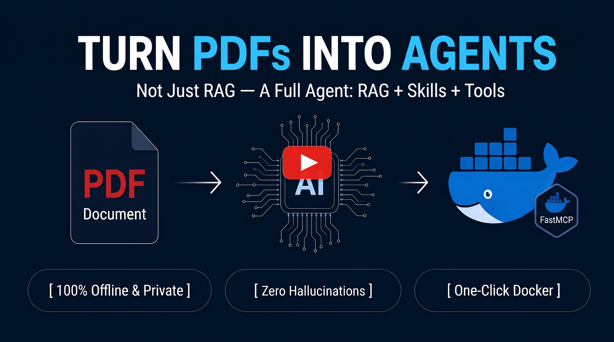

# 📘 PDFtoAgent 🤖

> **Turn domain literature into reusable AI-agent capabilities: searchable knowledge, domain guidance, and tested Python tools delivered over MCP. Try the pre-built Hamilton showcase with Windows Portable or Docker.**

[](https://github.com/babaksh/PDFtoAgent/raw/main/dist/PDFtoAgent-Portable-stock-market-barometer-hamilton.zip)
[](https://hub.docker.com/u/babak60)
[](https://modelcontextprotocol.io)
[](https://python.org)
[](https://github.com/babaksh)
[](https://github.com/babaksh/PDFtoAgent/actions/workflows/security-scan.yml)
[](https://hol.org/registry/plugins/babaksh%2Fpdftoagent)
[]()
[-blue)](LICENSE)
[](#-pre-built-showcase-william-peter-hamilton-dow-theory)

---

<p align="center">
  <a href="https://www.youtube.com/watch?v=5ytxQepI5mY" target="_blank">
    
  </a>
  <br>
  <sub>🎬 <b>Watch Video Walkthrough (1m 24s):</b> Click the image above to play on YouTube</sub>
</p>

---

## What You Can Try Here

This repository distributes a **pre-built Hamilton Dow-Theory MCP agent**, a sample dataset, a video walkthrough, and connection instructions. You can download and evaluate that agent under the [Community & Research License](LICENSE).

The **PDF-to-agent conversion engine and its authoring UI are not included in this repository**. Running the Hamilton package does not upload or compile another PDF. For custom document conversion and deployment, see [Custom Compilation](#-enterprise-solutions--custom-compilation).

## 💡 From Retrieved Text to Executable Procedures

Retrieval helps an AI assistant find relevant passages. Calculations and operational procedures also need explicit inputs, executable logic, and evidence that the implementation follows the source. PDFtoAgent brings these together in a **RAG + Domain Skill + Tools** package:

1. 📚 **Chapter-Level Vector RAG:** Semantic search with chapter/page references and available figures or tables.
2. 🧠 **Domain Skill (`SKILL.md`):** Guidance for applying source-supported procedures and interpreting their limitations.
3. ⚙️ **Python Tools:** Repeatable calculations and procedures, checked during generation with sandbox execution and source-based expectations.

| Capability | What the package provides |
|---|---|
| Source lookup | Searchable book knowledge and references |
| Procedure guidance | Domain skill and tool documentation |
| Computation | Python functions with explicit inputs and outputs |
| Validation | Generation-time execution checks and source-fidelity review |
| Tool discovery | A progressive-disclosure router for large tool catalogs |

Deterministic execution makes a calculation repeatable; it does not prove that its formula, assumptions, or domain interpretation are correct for every input. Validation covers the checks performed, and documented assumptions still need review.

---

## 🏛️ The Engine: Five-Tier Validation

The current authoring pipeline coordinates five tiers. This describes the latest engine; the downloadable Hamilton package is an existing showcase and has not been regenerated by this documentation update.

```text
Domain PDF
  → Phase 1: ingestion, chapter Markdown, figures and source references
  → Phase 2: tool generation and review
      Tier 1: Planner + pre-build Value Gate
      Tier 2: Agent Writer + Docker Sandbox Gate
      Tier 3: Deterministic Robustness Gate (no LLM tokens)
      Tier 4: Independent LLM Judge (implementation vs source contract)
      Tier 5: Redundancy + Catalog Integrity Audit (operator advice)
  → Phase 3: domain skill, knowledge store and MCP tool router
  → Distribution: Windows Portable or Docker
```

### How the latest Phase-2 improvements affect generation

- **Capability coverage:** the planner accounts for reusable procedures throughout a chapter. Short formulas can be useful, related variants can share an interface, and narrative material can remain knowledge. Seven tools is a planning preference, not a compulsory count or hard cap.
- **Practical tests:** compact independent checks cover realistic inputs, relevant boundaries and meaningful parameter changes. Exhaustive API permutations and full-floating-point-range stress campaigns are not required. Ordinary-input errors, wrong formulas and genuine singularity errors still block.
- **Visible numerical limitations:** an out-of-domain numerical finding becomes an advisory only when the judge explicitly confirms the provided input was correct. Its reason remains visible as `needs-review`, not strong verification.
- **Fewer repeated checks:** within one chapter run, an unchanged tool's successful gate can be reused during repairs to another tool. Changes to code, tests, source context, contracts, evidence or verification configuration require revalidation. This is not a persistent cache across separate runs.
- **More reliable evidence:** nested/indexed expected-output paths are resolved, and expected-value caches are separated by tool identity. Failed or explicitly unverified earlier tools are excluded from dependency digests.
- **Clearer reporting:** coverage, gate outcomes and review findings remain visible. Provenance lists describe source rules and chosen assumptions; their relative lengths are not percentages of correct or source-derived code and do not contribute to value scoring. Unknown model pricing is labeled unknown in the quality report.
- **Durable chapter logs:** each chapter keeps an append-only CLI log with run identifiers. The book log aggregates chapter histories, and the authoring UI's Execution Stream follows the selected chapter or All Chapters scope.

These controls improve traceability and reduce avoidable repair work. They do not guarantee one-attempt generation, complete semantic coverage or numerical correctness over every possible input.

---

## 📊 Pre-Built Showcase: William Peter Hamilton (Dow Theory)

The Hamilton showcase turns **The Stock Market Barometer** into a downloadable MCP agent for historical and technical research. Its bundled metadata lists **112 domain tools**. The historical package is separate from the latest authoring-engine changes described above.

The delivered package is a turnkey, multi-component showcase:

* 📚 **Full-Book Chapter-by-Chapter Vector RAG:** Semantic search over the packaged chapter knowledge with page-level references (`sqlite-vec` + local embeddings).
* 🧠 **Specialized Dow Theory Domain Skill (`SKILL.md`):** Deep codified market philosophy, rule interpretation protocols, and procedural decision trees directly distilled from Hamilton's work.
* ⚙️ **112 Domain Tools:** Quantitative procedures and interpretive helpers, including double top/bottom detectors, 3/8ths retracement rules, primary/secondary trend classifiers, line formation breakout tests, and speculative volume balance metrics.
* 🎛️ **Progressive Disclosure Router:** Exposes only 3 lightweight router meta-tools (`search_tools`, `get_tool`, `run_tool`) so a client can discover relevant tools without loading every definition up front.
* 📋 **Assumptions and Limits:** Parameters such as swing windows and detection tolerances include implementation choices. Interpretive helpers are not source-proven trading rules; tool count and successful execution are not measures of predictive accuracy.

---

## 🚀 Delivery & Execution Guide

Follow these simple steps to run the **Hamilton Dow-Theory MCP Server** on your local machine and connect it to **your favorite Agentic Apps** (Claude Desktop, ChatGPT, Antigravity, OpenClaw, Cursor, etc.).

Choose the execution method that best fits your environment:

| Execution Method | Target Platform | Prerequisites | Setup Effort |
| :--- | :--- | :--- | :--- |
| **[⚡ Method 1: Standalone Portable Bundle](#-method-1-standalone-portable-bundle-recommended-for-windows)** | **Windows (10 / 11)** | Ollama (only for RAG embeddings; auto-handled by script) | 🟢 **1-Click Launch (`run_server.bat`)** |
| **[🐳 Method 2: Docker Container Image](#-method-2-docker-container-image-cross-platform)** | **macOS / Linux / Windows** | Docker Desktop & Ollama (only for RAG embeddings) | 🟢 **Standard Container Run** |

---

### ⚡ Method 1: Standalone Portable Bundle (Recommended for Windows)

The **Portable Distribution** is a ComfyUI-style, fully self-contained package created by [Babak](https://github.com/babaksh). It runs 100% locally on Windows **without requiring Docker Desktop, WSL2, or a system Python installation**.

```
┌────────────────────────┐       ┌────────────────────────┐       ┌────────────────────────┐
│  Step 1: Download .zip │ ───>  │  Step 2: Start Server  │ ───>  │  Step 3: Connect Apps  │
│  (dist/ folder)        │       │  (run_server.bat)      │       │  (See Section 3 Below) │
└────────────────────────┘       └────────────────────────┘       └────────────────────────┘
```

#### Step 1.1: Download & Extract
1. Download **`PDFtoAgent-Portable-stock-market-barometer-hamilton.zip`** ([Direct Download Link](https://github.com/babaksh/PDFtoAgent/raw/main/dist/PDFtoAgent-Portable-stock-market-barometer-hamilton.zip) or browse the [dist/](dist/) folder).
2. Extract the archive into any folder on your machine (e.g., `D:\PDFtoAgent-Portable` or `C:\PDFtoAgent-Portable`).

#### Step 1.2: Launch the Server (`run_server.bat`)
Double-click **`run_server.bat`**. The intelligent PowerShell launcher automates the entire runtime setup:
* 🔍 **Automatic Ollama CLI Setup:** Checks if Ollama is installed on your PC. If missing, it automatically installs it via the Windows Package Manager (`winget`) or the official CLI installer—no manual hunting for installers needed.
* 📦 **Automatic Model Verification:** Checks whether the required `nomic-embed-text:v1.5` semantic embedding model is cached locally. If missing, it downloads it directly in your terminal.
* 🚀 **Background Daemon:** Starts the Ollama service in the background if it is not already running.
* 🛡️ **Bundled Python Runtime:** Runs from a self-contained, pre-packaged virtual environment with all 100+ Dow Theory calculation tools, SQLite vector store, and FastMCP libraries ready to use.
* 🌐 **Server Online:** Binds strictly to your loopback adapter at `http://127.0.0.1:8765/mcp`.

```
===================================================================================
   PDF     to     Agent  --  HAMILTON DOW THEORY (1922)
   Standalone Portable MCP Distribution | Built by Babak
===================================================================================
  [OK] Ollama is installed.
  [OK] Model nomic-embed-text:v1.5 is ready.
  [OK] Ollama service is running.
  [*] Starting FastMCP Server on http://127.0.0.1:8765/mcp ...
===================================================================================
```

#### Step 1.3: Connect Your Favorite AI Client
Once `run_server.bat` is running, your MCP server is listening at `http://127.0.0.1:8765/mcp`. You can connect **Claude Desktop**, **Google Antigravity**, **ChatGPT Desktop**, **Cursor**, or **OpenClaw** in seconds.

👉 Refer to **`README.txt`** inside your extracted folder or see the complete **[Client Connection Guide (CONNECTING_APPS.md)](CONNECTING_APPS.md)** for ready-to-paste JSON configs and UI steps.

#### Step 1.4 (Optional): Cloud Embeddings Mode
By default, embeddings use local Ollama. After initial setup, this avoids a remote embedding API. To use cloud embeddings instead of loading the embedding model locally (the server itself still uses memory):
1. Open `config/.env` inside the portable folder with any text editor.
2. Set the provider to `nomic`:
   ```env
   EMBEDDING_PROVIDER=nomic
   NOMIC_API_KEY=your_nomic_api_key
   ```
   *(Check current availability, usage limits and pricing with [Nomic](https://nomic.ai). Cloud embeddings send embedding requests to that provider.)*

---

### 🐳 Method 2: Docker Container Image (Cross-Platform)

For macOS, Linux, or Windows developers who prefer running through Docker Desktop, the server is available as an audited container image on Docker Hub.

#### Step 2.1: Prerequisites (One-Time Setup)

You only need to install these two tools once. After this setup, running any agent takes seconds.

##### Install Docker Desktop
1. Download and install **[Docker Desktop](https://www.docker.com/products/docker-desktop/)** for Windows, macOS, or Linux.
2. Launch Docker Desktop and verify the status icon shows **Engine Running** (green).

> 🛡️ **Container checks:** This repository includes an **Aqua Security Trivy** scan workflow; inspect its results for the relevant image/version. The example launch command publishes the MCP endpoint on local loopback (`127.0.0.1`). Local embeddings use the configured Ollama service; cloud embedding mode uses an external provider. Generation-time Docker validation and the downloadable Portable runtime are different execution environments.

##### Install Ollama & Pull Embedding Model
The MCP server uses a local embedding model for semantic knowledge retrieval (RAG) so that **no external API keys or cloud services are required**.

1. Download and install **[Ollama](https://ollama.com/download)**.
2. Open your terminal (PowerShell, CMD, or Terminal) and run:
   ```bash
   ollama pull nomic-embed-text:v1.5
   ```
   *(This downloads the lightweight 270 MB embedding model to your machine).*
3. Ensure Ollama is running (it runs automatically in the background on port `11434`).

#### Step 2.2: Run the Container

The server is packaged as a single self-contained Docker image that serves **Streamable HTTP** on port `8765` (path `/mcp`).

Open your terminal and run:

##### Windows / macOS (Docker Desktop):
```bash
docker run -d --restart unless-stopped --name pdftoagent-stock-market-barometer-hamilton \
  -p 127.0.0.1:8765:8765 \
  -e EMBEDDING_PROVIDER=ollama \
  -e OLLAMA_EMBEDDING_HOST=http://host.docker.internal:11434 \
  -e OLLAMA_EMBEDDING_MODEL=nomic-embed-text:v1.5 \
  -e MCP_TRANSPORT=streamable-http \
  babak60/pdftoagent-stock-market-barometer-hamilton:latest
```

##### Linux:
```bash
docker run -d --restart unless-stopped --name pdftoagent-stock-market-barometer-hamilton \
  -p 127.0.0.1:8765:8765 \
  --add-host=host.docker.internal:host-gateway \
  -e EMBEDDING_PROVIDER=ollama \
  -e OLLAMA_EMBEDDING_HOST=http://host.docker.internal:11434 \
  -e OLLAMA_EMBEDDING_MODEL=nomic-embed-text:v1.5 \
  -e MCP_TRANSPORT=streamable-http \
  babak60/pdftoagent-stock-market-barometer-hamilton:latest
```

---

### 3. Connect to Your Agentic Apps

Once the server is running (via Portable `.bat` or Docker), it listens on `http://127.0.0.1:8765/mcp`.

👉 **For complete step-by-step setup walkthroughs and ready-to-paste configurations for Claude Desktop, ChatGPT, Google Antigravity, Cursor, and OpenClaw, see the [Client Connection Guide (CONNECTING_APPS.md)](CONNECTING_APPS.md)** *(also included inside the Portable bundle as `README.txt`)*.

---

## 🧪 Test Drive: 6-Month Bitcoin Analysis

Included in this repository is [`data/btc_ohlcv.csv`](data/btc_ohlcv.csv), containing historical Bitcoin daily OHLCV data.

### The Test Prompt
Attach `data/btc_ohlcv.csv` in your connected Agentic App (Claude Desktop, ChatGPT, Antigravity, OpenClaw, Cursor, etc.) and send the following prompt:

```text
I have attached the daily Bitcoin price dataset (btc_ohlcv.csv).

Please extract and analyze the last 6 months of data using Charles Dow and William Peter Hamilton's principles from 'The Stock Market Barometer':
1. What is the Primary Trend (Bull or Bear) according to Dow's higher-high / lower-low comparison? Include exact swing high/low levels and the break percentage.
2. Are there any Double Top or Double Bottom patterns detected within Dow's tolerances?
3. Which of Dow's three movements is the latest price action (Primary, Secondary reaction, or Day-to-Day)?
4. Does volume behavior validate the trend according to Dow's rule that 'volume confirms movement'?

Format the response into an executive dashboard with status badges, numerical swing coordinates, and list the exact calculation tools executed along with their provenance metadata.
```

### What to Inspect in the Result

The connected client discovers applicable tools and supplies the required inputs. Depending on the question, it can use tools such as `bull_bear_higher_high_lower_low_test`, `double_top_bottom_detector`, and `dow_three_movement_classification` through the router.

Review the executed tool names, input data range, chosen swing/tolerance parameters, numerical outputs, and source references. Results depend on the dataset and parameters; this README does not prescribe a fixed BULL/BEAR answer or a guaranteed pattern detection. Some classification tools need caller-supplied context rather than inferring every part of a trading interpretation.

The Python runtime executes locally through whichever delivery method you selected. The connected AI client's own model and data-handling settings are separate from the MCP server.

---

## 🗺️ Roadmap & Pre-Built Agent Catalog

| Agent / Domain | Source Book | Status | Distribution Formats |
| :--- | :--- | :--- | :--- |
| **Dow Theory Quantitative Engine** | *The Stock Market Barometer* (1922) | 🟢 **Available** | 📦 **[Download Portable .zip](https://github.com/babaksh/PDFtoAgent/raw/main/dist/PDFtoAgent-Portable-stock-market-barometer-hamilton.zip)**<br>🐳 `babak60/pdftoagent-stock-market-barometer-hamilton` |
| **Tape Reading & Speculation** | *Reminiscences of a Stock Operator* (1923) | 🟡 In Pipeline | Portable .zip + Docker |
| **Market Cycles & Price Structure** | *Richard D. Wyckoff Method* (1910–1931) | 🟡 In Pipeline | Portable .zip + Docker |
| **Classical Scientific & Medical Reference** | Foundational Domain Treatises | ⚪ Planned | Portable .zip + Docker |

---

## 🏢 Enterprise Solutions & Custom Compilation

Have proprietary technical manuals, financial underwriting policies, compliance rulebooks, or internal SOPs?

Custom engagements can cover document conversion, tool review, integration and deployment requirements:
* **Deployment planning:** Discuss local, on-premise or VPC execution, including the selected model, embedding services and any offline requirements. A local MCP endpoint alone does not establish an air-gapped end-to-end workflow.
* **Tool generation and review:** Turn supported procedures into executable tools with source references, test evidence and documented assumptions.
* **Contact:** Connect with me for pilot programs and enterprise integrations at [`Babak`](https://github.com/babaksh) on GitHub or open an issue.

---

## ⚠️ Financial & Trading Disclaimer

* **No Financial Advice:** The materials, analysis, algorithms, and tools provided in this repository and within the generated MCP agents (including the Dow Theory and market barometer agents) are strictly for **educational, historical, and technical research purposes only**.
* **Not a Financial Advisor:** I am not a registered investment advisor, broker-dealer, or financial analyst. Nothing contained in this project constitutes investment, trading, legal, or financial advice.
* **User Responsibility:** Any trading or investment decisions made using these tools or their outputs are made entirely at your own risk. Past performance or historical algorithmic principles described in century-old literature do not guarantee future market results. Always conduct your own due diligence and consult with a licensed financial professional before risking capital.

---

## 📄 License

This showcase repository, the sample dataset, and the pre-compiled container images are released under the **PDFtoAgent Community & Research License (Non-Commercial)**:
* **Free for Personal, Educational, and Research Use:** You are welcome to run, study, and test the agent locally.
* **Commercial Redistribution Prohibited:** Sublicensing, commercial resale, hosting as a paid SaaS/API service, or repackaging into proprietary products is strictly prohibited without prior written permission.
* **Full Terms:** See the [`LICENSE`](LICENSE) file for complete legal details.
* **Commercial & Enterprise Inquiries:** To license for commercial production use or discuss custom agent compilation, contact [`Babak`](https://github.com/babaksh).

---

## ⚖️ Source Material & Reuse

* The showcase references William Peter Hamilton's historical *The Stock Market Barometer*. Source edition, later additions and territorial reuse rights should be checked for the intended use; a publication date is not a blanket worldwide permission statement.
* The software package is governed by the [Community & Research License](LICENSE). Its availability here does not grant commercial rights beyond those terms.
* For custom compilation, use documents you own or have the necessary permission to process and distribute. The rights to a source document and to a software package are separate considerations.

---

<div align="center">
  <b>Turn your PDF into Action.</b><br>
  Maintained by <a href="https://github.com/babaksh">Babak</a>
</div>
